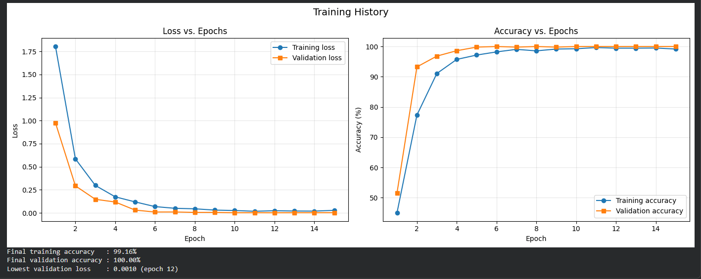
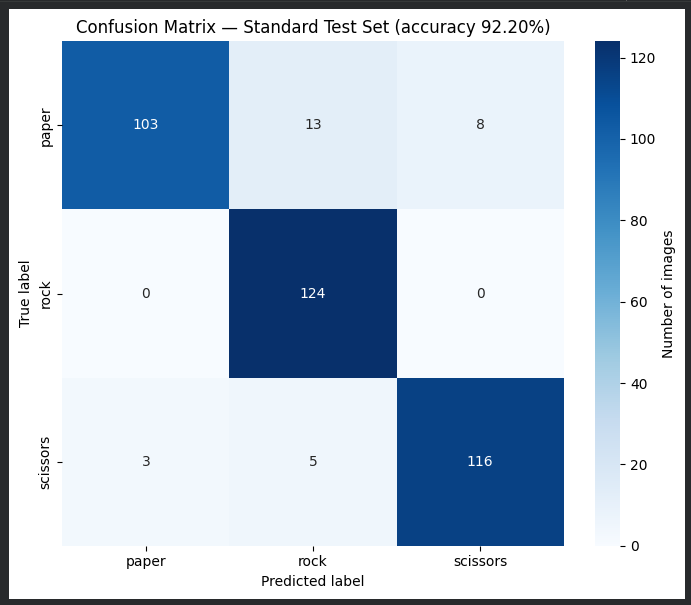
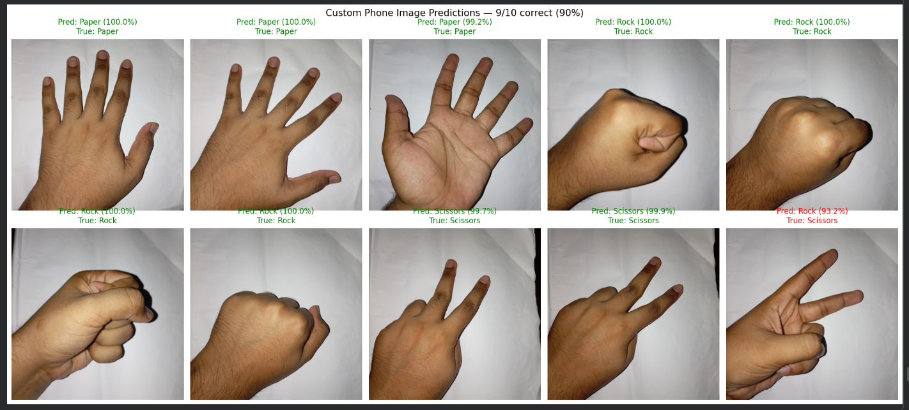
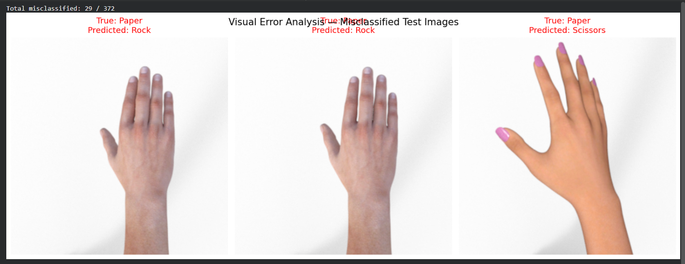

# CNN Rock–Paper–Scissors Classifier by Md. Raihan Hossen. Id: 220105

## Results

**Standard test set accuracy: 92.20% (343 / 372)**

| Class | Accuracy | Precision | Recall | F1‑score |
|---|---|---|---|---|
| Paper | 83.06% (103/124) | 0.9717 | 0.8306 | 0.8957 |
| Rock | 100.00% (124/124) | 0.8732 | 1.0000 | 0.9323 |
| Scissors | 93.55% (116/124) | 0.9355 | 0.9355 | 0.9355 |

**Custom smartphone photo accuracy: 9 / 10 = 90.0%**

The model generalizes well beyond the CGI‑rendered training data despite a visible domain gap (real phone photos are darker and less uniform than the synthetic training images). Paper was the hardest class to recognize (most confused with scissors), while rock was classified perfectly.

---

## Plots

**Training History** - Loss vs. Epochs and Accuracy vs. Epochs for training and validation sets.

**Confusion Matrix** - heatmap of predictions vs. true labels on the standard test set.

**Custom Prediction Gallery** - all 10 phone images with predicted class and confidence (e.g. "Pred: Rock (98.5%)"), green for correct and red for incorrect.

**Visual Error Analysis** - 3 randomly sampled misclassified test images with true vs. predicted labels.

---

## Architecture

A custom CNN (`class CNN(nn.Module)`) with four convolutional blocks followed by a fully connected classifier head:

| Layer | Details |
|---|---|
| Conv Block 1 | `Conv2d(3 → 32, 3×3, pad=1)` → `BatchNorm2d` → `ReLU` → `MaxPool2d(2,2)` |
| Conv Block 2 | `Conv2d(32 → 64, 3×3, pad=1)` → `BatchNorm2d` → `ReLU` → `MaxPool2d(2,2)` |
| Conv Block 3 | `Conv2d(64 → 128, 3×3, pad=1)` → `BatchNorm2d` → `ReLU` → `MaxPool2d(2,2)` |
| Conv Block 4 | `Conv2d(128 → 128, 3×3, pad=1)` → `BatchNorm2d` → `ReLU` → `MaxPool2d(2,2)` |
| Flatten | `128 × 8 × 8 → 8192` |
| Dropout | `p = 0.5` |
| FC1 | `Linear(8192 → 256)` → `ReLU` |
| FC2 (output) | `Linear(256 → 3)` |

Input images are 128×128 RGB. Four conv+pool stages progressively shrink the spatial resolution from 128×128 down to 8×8 while increasing channel depth from 3 to 128. Batch normalization stabilizes training, and dropout (p=0.5) is applied before the dense layers to reduce overfitting. Trained with `nn.CrossEntropyLoss` and the `Adam` optimizer (lr=0.001) for 15 epochs, batch size 64.